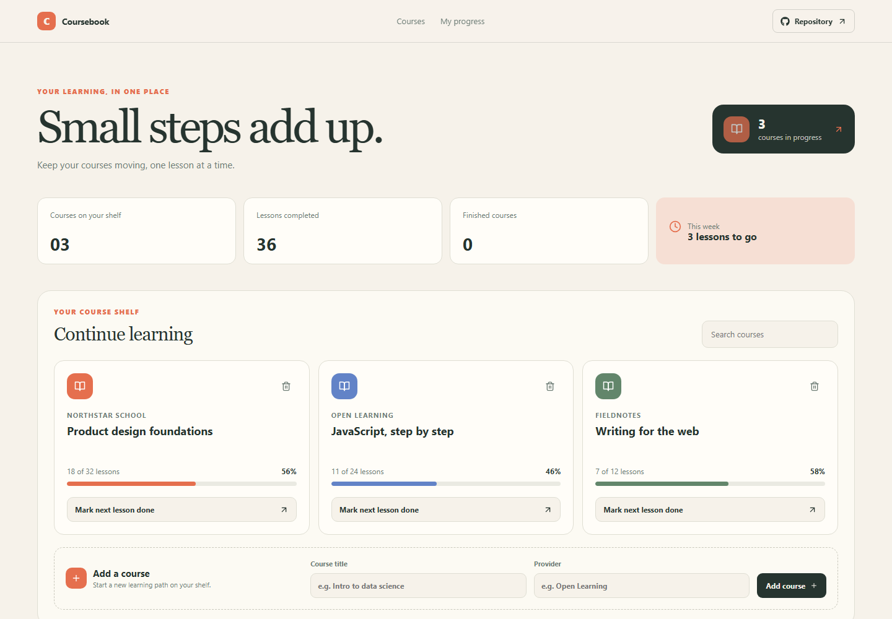

# Coursebook

Coursebook is a personal course dashboard for keeping lesson progress visible across several learning paths.

Live site: https://a2rp.github.io/course-progress-tracker/

## How to use it

Choose a course card and mark the next lesson complete. Add a course with its title and provider, search by either value, and remove a course through the confirmation dialog.

## Features

- Course progress cards with lesson totals and completion percentages
- Search by course title or provider
- Add a course to the local shelf
- Mark lessons complete with progress capped at the course total
- Confirmation before removing a course

## Data and limits

Courses and lesson counts are saved in this browser with localStorage. A newly added course starts with ten lessons because the app does not connect to a course provider.

The dashboard does not import course data, sync across devices, or track provider lesson contents. It is a manual progress log.

## Run locally

Install Node.js, then run these commands from the project folder:

    npm install
    npm run dev

## Checks and deployment

    npm run lint
    npm run build
    npm run deploy

The deploy command builds the site and publishes the contents of dist to the gh-pages branch. The project is configured for GitHub Pages at https://a2rp.github.io/course-progress-tracker/.

## Future improvements

These are ideas only and are not implemented yet:

- Connect course links and lesson outlines (idea, not implemented)
- Add weekly goals and reminders (idea, not implemented)
- Export the course shelf as a file (idea, not implemented)

## Links

- Portfolio: [https://www.ashishranjan.net](https://www.ashishranjan.net)
- GitHub: [https://github.com/a2rp](https://github.com/a2rp)
- CodePen: [https://codepen.io/ash1198](https://codepen.io/ash1198)
- LinkedIn: [https://www.linkedin.com/in/aashishranjan](https://www.linkedin.com/in/aashishranjan)
- Facebook: [https://www.facebook.com/theash.ashish/](https://www.facebook.com/theash.ashish/)
- YouTube: [https://www.youtube.com/@ashishranjan-ashz?sub_confirmation=1](https://www.youtube.com/@ashishranjan-ashz?sub_confirmation=1)
- Email: [mailto:ash.ranjan09@gmail.com](mailto:ash.ranjan09@gmail.com)

## Support

- Support: [https://a2rp-donation-page.netlify.app/](https://a2rp-donation-page.netlify.app/)
- Buy Me a Coffee: [https://buymeacoffee.com/ashishranjan](https://buymeacoffee.com/ashishranjan)
- Patreon: [https://www.patreon.com/ashishranjan](https://www.patreon.com/ashishranjan)